# IMMERGAS Modbus BMS NASA Hub

[English](README.md) · **Polski**

[](https://github.com/jotuera/immergas-modbus-bms-nasa-hub/releases/latest)
[](https://esphome.io)
[](https://docs.m5stack.com/en/core/AtomS3%20Lite)
[](https://hacs.xyz)
[](LICENSE)
[](https://buymeacoffee.com/jotuera)

Jedno urządzenie ESPHome, które łączy z Home Assistantem **wszystkie trzy magistrale** pompy ciepła Immergas Magis Pro
/ Magis Combo V2, oraz zestaw kart Lovelace, które robią z nich jeden czytelny dashboard.

> Zbudowany i przetestowany na Immergas **Magis Combo 9 Plus V2** z jednostką zewnętrzną **Audax Pro 9 V2**
> (Samsung EHS). Inne urządzenia Immergas z tymi samymi magistralami D+/D-, T-/T+ i F1/F2 (Magis Pro V2 i inne)
> najpewniej też zadziałają – hub loguje to, co widzi, więc model, który się różni, da się dostroić na podstawie logów.

| Potwierdzony model | Kto potwierdził | Magistrale |
|---|---|---|
| Magis Combo 9 Plus V2 + Audax Pro 9 V2 | autor | D+/D-, T-/T+, F1/F2 |
| Magis Hercules Pro 9 | użytkownik | D+/D- (emulacja Dominusa i panelu strefy 1, grzanie i chłodzenie) |

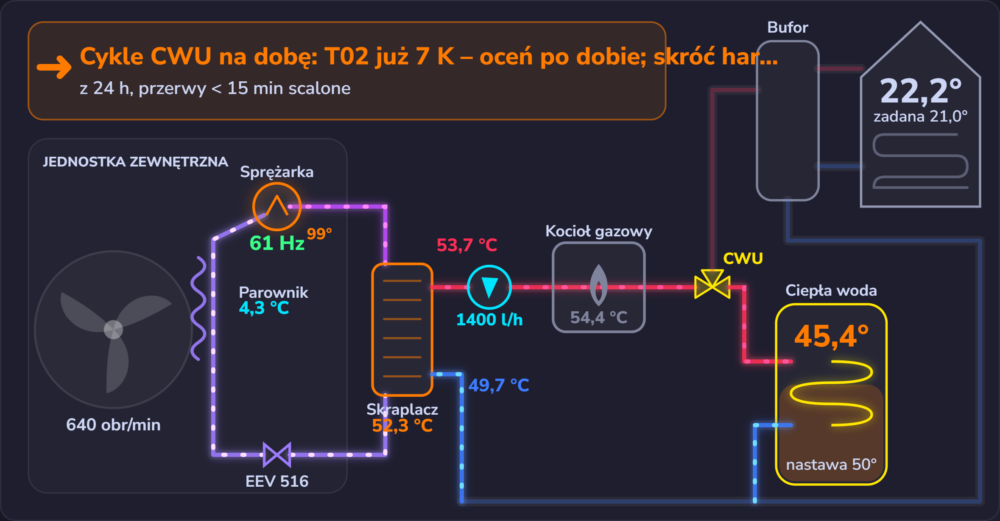

| Magistrala | Co robi na niej hub | Co dostajesz w Home Assistant |
|---|---|---|
| **D+/D-** (piec ↔ Dominus / panel strefy) | emuluje panel pokojowy strefy 1 (0x29) obok prawdziwego Dominusa albo sam Dominus | tryb pracy, termostaty stref 1–3, źródła temperatury i wilgotności, presety Komfort / Eko, programy czasowe i kalendarze CO i CWU, CWU Komfort / Eko wg harmonogramu, stan pompy ciepła, kod błędu pieca z opisem w 11 językach |
| **T-/T+** (Modbus BMS) | master Modbus, piec jest slave 11 | parametry instalatora (krzywa R04/R05, integracja I01–I10, prędkości pompy A03/A04, anty-legionella P15, odpowietrzanie A12 / U50…), stan systemu D97–D99, szacowanie gazu (Combo), sterowanie źródłem ciepła |
| **F1/F2** (Samsung NASA, jednostka wewnętrzna ↔ zewnętrzna) | słucha wszystkiego, zapisuje tylko krótką białą listę | częstotliwość i limity sprężarki, tłoczenie / parownik / faza ciekła, EEV, wentylator, prądy i napięcia, odszranianie, flagi, wartości FSV; tryb wyjazdowy, ograniczenie częstotliwości sprężarki (FR) i cele trybu wyjazdowego FSV 5011–5019 |

Ponad trzema magistralami hub liczy to, czego żadna z nich nie pokazuje osobno: **COP** (teraz / dziś), moc cieplną,
**stan pracy**, starty i czas pracy sprężarki i palnika dziś, gaz zużyty dziś, ostatni **cykl CWU** (energia, ciepło,
COP, koszt) oraz **koszt 1 kWh ciepła** z pompy, z kotła gazowego i z grzałki.

## Dashboard

Karty same znajdują hub i wszystkie jego encje: bez identyfikatorów encji i bez YAML. Cały dashboard to jedna linijka:

```yaml
strategy:
  type: custom:immergas-hub
```

| | |
|---|---|
| 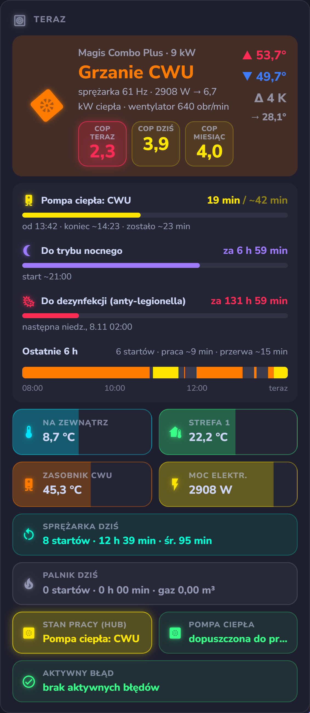 | 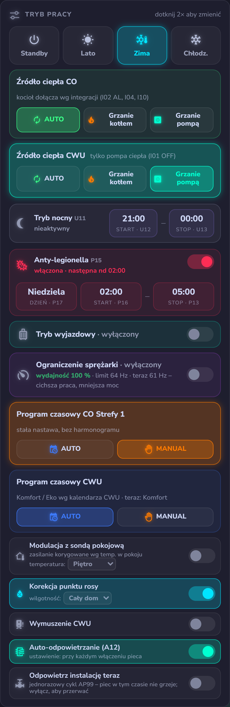 |
| **Teraz** — stan, COP teraz / dziś, liczniki cykli z typową długością, ostatnie 6 h, sprężarka i palnik dziś | **Tryb pracy** — tryby (dotknij 2×), źródło ciepła CO i CWU, funkcja nocna U11, anty-legionella P15, tryb wyjazdowy, ograniczenie sprężarki, programy czasowe CO i CWU, przełączniki |
| 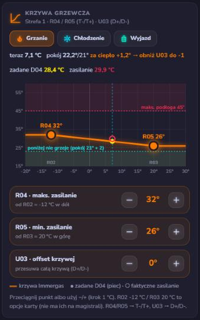 | 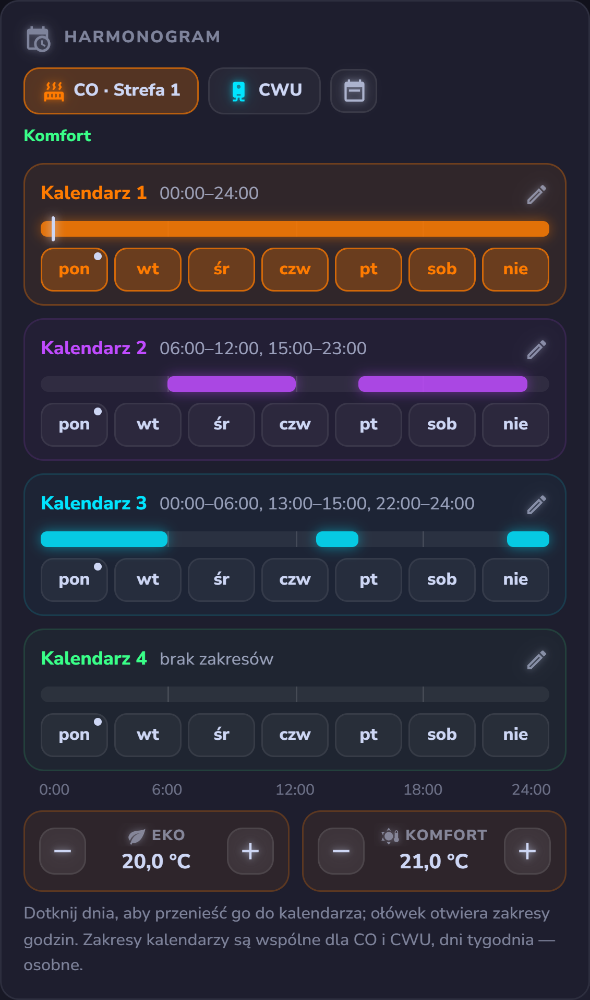 |
| **Krzywa grzewcza** — R04 / R05 / U03 z punktami do przeciągania, krzywe chłodzenia i trybu wyjazdowego | **Harmonogram** — 4 kalendarze pieca dla CO i CWU, jak w aplikacji Dominus |
| 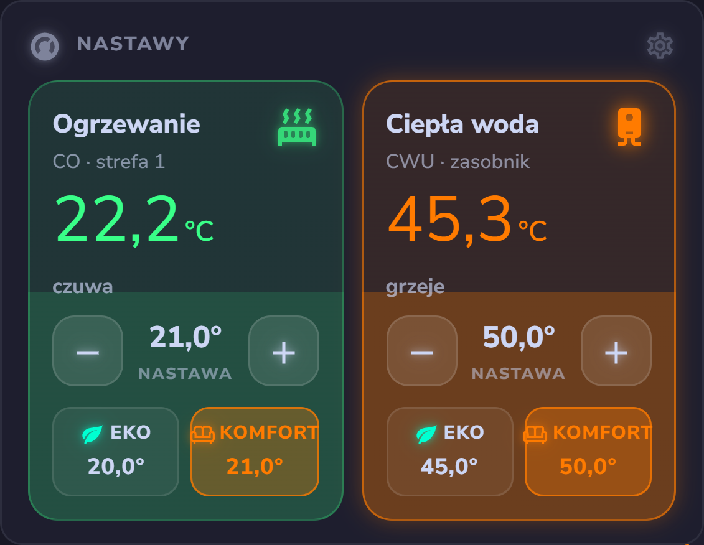 | 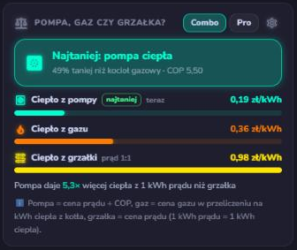 |
| **Nastawy** — strefa 1 i ciepła woda z Eko / Komfort | **Pompa, gaz czy grzałka?** — koszt 1 kWh ciepła z każdego źródła |

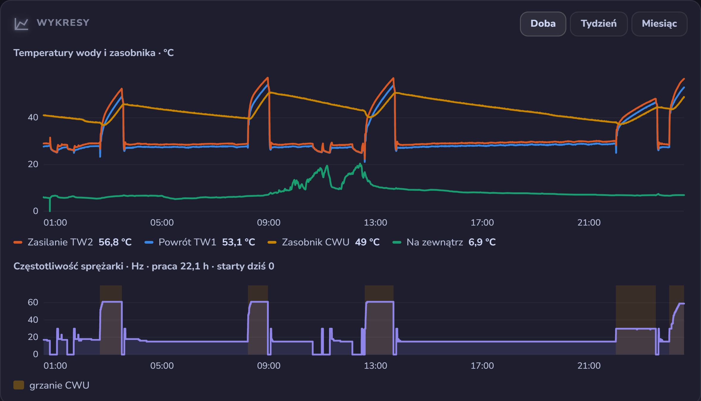

**Łączność** – wszystkie magistrale i urządzenia, z którymi rozmawia hub, w jednym miejscu: zielony = połączono, niebieski = emulowane przez hub.

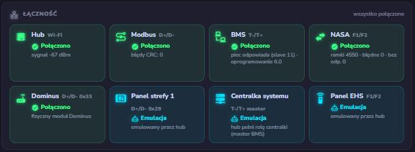

Pozostałe karty: obieg wodny i chłodniczy, stan urządzeń, ostatni cykl CWU, [Kalibracja](#kalibracja),
automatyzacje i ustawienia huba. Szczegóły, opcje i instalacja (HACS albo ręczna): [cards/README.pl.md](cards/README.pl.md).
Napisy są w języku Home Assistanta: polski, angielski, czeski, niemiecki, hiszpański, francuski, węgierski, włoski,
niderlandzki, portugalski, słowacki.

## Kalibracja

Karta Kalibracja to instalator pomp ciepła zamknięty w karcie. Przechodzi przez każdy parametr, który hub widzi na
trzech magistralach, i pokazuje obok siebie trzy wartości:

- **Model** – co powinna mieć pompa ciepła z ogrzewaniem podłogowym, z uzasadnieniem w jednej linijce;
- **Obecnie** – co ma teraz twoja instalacja;
- **Rekomendacja** – co zmienić, policzone z ostatnich 24 h historii: startów sprężarki na godzinę i długości cykli,
  cykli CWU na dobę, COP wobec modelu 45 % Carnota, termostatów pokojowych, temperatury zewnętrznej oraz twoich cen
  prądu i gazu. Przycisk **Ustaw** (dotknij 2×) wprowadza zmianę.

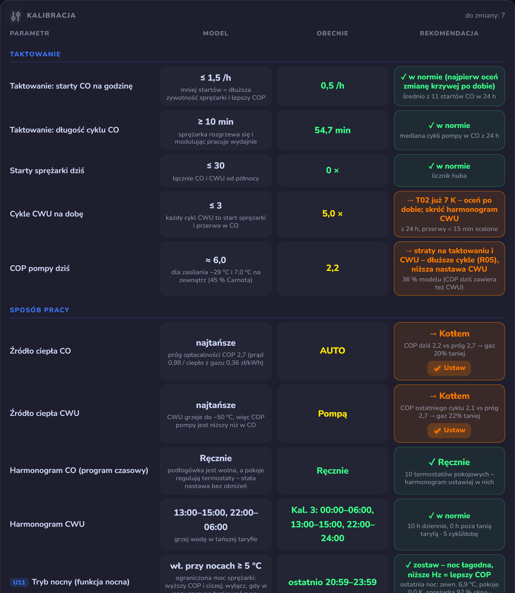

Grupy: taktowanie, sposób pracy (źródło ciepła CO i CWU z progu opłacalności COP, harmonogram CO i CWU w tańszej
taryfie, funkcja nocna U11, ograniczenie sprężarki FR, anty-legionella P15), ogrzewanie i krzywa (R04 / R05 / U03,
modulacja z sondą pokojową, limit podłogi), ciepła woda, pompa obiegowa (A03 / A04 i ΔT zasilanie–powrót), integracja
z kotłem (I01–I10, tylko Magis Combo), chłodzenie i inne. Pod tabelą: **ukryte ustalenia**, których wyświetlacz pieca
nigdy nie pokaże (odszraniania, oblodzenie parownika, pobór w czuwaniu, nocne straty zasobnika, kocioł dołączający przy
łagodnej pogodzie, wysokie tłoczenie) oraz **skuteczność optymalizacji**: koszt na stopniodzień, koszt 1 kWh ciepła,
prąd i gaz na stopniodzień, COP, starty na godzinę i długość cyklu przed zmianą i po niej, z oceną łączną. Po każdej
zmianie naciśnij w hubie *Porównanie od teraz*, a karta zmierzy efekt.

## Sprzęt

| Element | |
|---|---|
| [M5Stack AtomS3 Lite](https://docs.m5stack.com/en/core/AtomS3%20Lite) | ESP32-S3 |
| podstawka M5Stack ATOMIC PortABC | trzy porty Grove: A, B, C |
| 3× M5Stack Isolated RS485 Unit | izolacja galwaniczna, automatyczny kierunek (bez pinu DE) |

Użytkownicy zgłaszają też działanie na **Waveshare ESP32-S3-RS485-CAN** (na szynę DIN) z własnymi ustawieniami pinów.

| Port | Magistrala | GPIO RX / TX | Transmisja | Terminacja 120 Ω |
|---|---|---|---|---|
| A | D+/D- | 39 / 38 | 9600 8E1 | **ON** |
| B | F1/F2 | 8 / 7 | 9600 8E1 | OFF |
| C | T-/T+ | 6 / 5 | 9600 (piec nadaje 8N2, hub odbiera z 1 bitem stopu) | OFF |

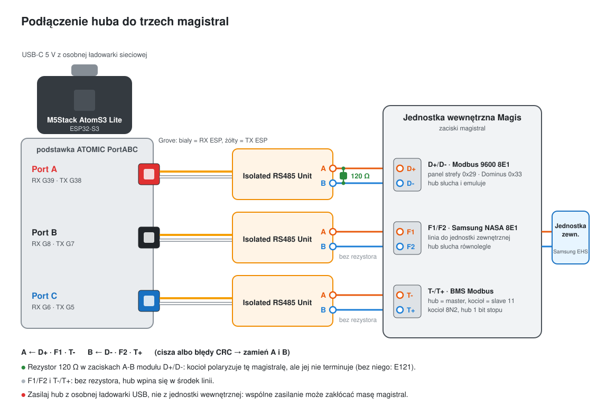

Zasady podłączenia:

- **D+/D- wymaga terminatora 120 Ω.** Kocioł daje na tej magistrali polaryzację, ale jej nie terminuje. Włóż rezystor 120 Ω
  w zaciski A i B modułu RS485 portu A, razem z przewodami D+ i D-. Bez niego hub co jakiś czas „znika”
  z magistrali, a kocioł pokazuje **E121**.
- **F1/F2 i T-/T+: terminacja OFF.** Hub wpina się w środek tych linii, ich końce są już zakończone.
- **Polaryzacja:** D+ → A, D- → B; F1 → A, F2 → B; T- → A, T+ → B. Cisza na magistrali albo błędy CRC to zwykle
  zamienione przewody; na T-/T+ dobrą polaryzację potwierdza **ikona BMS** na wyświetlaczu kotła.
- **Biały przewód Grove = RX ESP.** Przy zamienionych RX i TX hub nie odbiera nic albo same śmieci.
- **Osobne zasilanie.** Zasilaj AtomS3 z osobnej ładowarki USB wpiętej do gniazdka, nie z elektroniki jednostki
  wewnętrznej. Zasilanie wspólne z jednostką może zakłócać masę magistral i powodować błędy komunikacji.

Więcej w [bazie wiedzy, rozdział 2](docs/knowledge-base.pl.md#2-sprzęt-i-podłączenie).

Działają też inne płytki ESP32: ustaw podstawienia `*_uart_rx_pin` / `*_uart_tx_pin` (oraz `*_uart_de_pin` przy
transceiverze z pinem kierunku) i pomiń `hw_atoms3_portabc.yaml`.

> ⚠️ Magistrale są wewnątrz urządzenia i łączą się z elektroniką zasilaną z sieci. Przed otwarciem czegokolwiek odłącz
> zasilanie, a podłączenie zostaw komuś z uprawnieniami. Podłączenie obcego sprzętu do urządzenia może mieć wpływ na
> gwarancję – najpierw zapytaj instalatora. To niezależny projekt: nie jest tworzony, zatwierdzany ani wspierany przez
> Immergas ani Samsung. Używasz go na własną odpowiedzialność.

## Instalacja

1. Skopiuj [examples/immergas-hub.yaml](examples/immergas-hub.yaml) do folderu ESPHome i dodaj sekrety, których używa
   (`wifi_ssid`, `wifi_password`, `immergas_hub_api_key`, `immergas_hub_ota_password`,
   `immergas_hub_web_username`, `immergas_hub_web_password`).
2. Wybierz język nazw encji: `packages/lang/hub_xx`, `dd_xx`, `tt_xx` (cs, de, en, es, fr, hu, it, nl, pl, pt, sk)
   oraz `f1f2_xx` (en, pl).
3. Na pierwsze uruchomienie zostaw bezpieczne ustawienia z przykładu: hub tylko słucha na D+/D- i nie zapisuje na
   F1/F2 (zobacz [Pierwsze uruchomienie](#pierwsze-uruchomienie)).
4. Magis Pro (bez kotła gazowego): zostaw wszystkie pakiety. Karty czytają model systemu (D61) i przechodzą na widok
   Pro: bez kosztów gazu, bez wiersza palnika, bez integracji z kotłem w Kalibracji.
5. Wgraj, dodaj urządzenie w Home Assistant, zainstaluj karty przez HACS ([cards/README.pl.md](cards/README.pl.md)) i utwórz
   dashboard strategią z punktu wyżej.

Po pierwszym uruchomieniu ustaw raz w encjach konfiguracyjnych huba wartości, których nie ma na żadnej magistrali,
takie same jak w menu pieca: okno funkcji nocnej **U12 / U13**, anty-legionellę **P16 / P17 / P13**, limit zasilania
podłogi, cenę prądu i gazu, pojemność zasobnika CWU oraz — dla karty Kalibracja — godziny tańszej taryfy. Walutę cen
ustawia podstawienie `hub_currency`.

## Pierwsze uruchomienie

Idź krok po kroku i po każdym kroku sprawdź kartę **Łączność**:

1. **Tylko nasłuch.** Po wgraniu hub czyta wszystkie trzy magistrale, ale niczego nie emuluje na D+/D- i nie zapisuje
   na F1/F2. W karcie Łączność *Modbus*, *BMS* i *NASA* powinny zrobić się zielone w ciągu minuty–dwóch; *Hub* pokazuje
   sygnał Wi-Fi. Jeśli któraś magistrala zostaje czerwona, sprawdź jej podłączenie (biały przewód = RX), zanim pójdziesz
   dalej.
2. **Emulacja D+/D-.** Włącz urządzenie, którego brakuje na magistrali – *Emuluj Panel Strefy 1*, gdy jest prawdziwy
   Dominus (jak na instalacji testowej), albo *Emuluj Dominus*, gdy go nie ma. Kafelek zmieni się na niebieski
   (*Emulacja*), a piec zacznie brać nastawy z Home Assistanta. Urządzenie, które już odpowiada pod tym adresem, blokuje
   emulację, więc hub nigdy nie zagłuszy prawdziwego panelu.
3. **Zapis na F1/F2.** Dopiero gdy odczyty wyglądają dobrze, włącz *Aktywne sterowanie ODU*, żeby używać trybu
   wyjazdowego i ograniczenia sprężarki (FR). Po restarcie wyłącza się znowu; ustaw `f1f2_write_arm_restore: ALWAYS_ON`,
   żeby został włączony.
4. **Wartości z menu pieca.** Ustaw raz to, czego nie ma na żadnej magistrali (okno nocne U12 / U13, anty-legionella
   P16 / P17 / P13, limit podłogi, ceny, pojemność zasobnika, godziny taryfy) – zobacz [Instalacja](#instalacja).

## Gaz w panelu Energia

W Magis Combo hub wystawia encję **Immergas TT - Gaz szacowane zużycie** (m³, `device_class: gas`,
`state_class: total_increasing`), gotową do panelu Energia w Home Assistancie: *Ustawienia → Dashboardy → Energia →
Zużycie gazu → Dodaj źródło gazu* i wybierz tę encję. Home Assistant pokaże wtedy zużycie gazu przez kocioł w podziale
na godziny, dni i miesiące obok prądu pompy ciepła, a po podaniu ceny gazu także jego koszt.

Kocioł nie ma własnego licznika gazu, więc wartość jest **szacunkiem**: czas pracy palnika × zużycie na godzinę,
osobno dla ogrzewania i CWU, zapamiętywany we flashu huba. Skalibruj go raz: zapisz stan gazomierza i encji na początku
i na końcu okresu (kilka dni z pracującym kotłem), podziel przyrost gazomierza przez przyrost encji i pomnóż obie
wartości *Gaz zużycie CO / CWU (kalibracja)* przez ten współczynnik. *Gaz: wyzeruj licznik* zaczyna od zera.
W Magis Pro (bez kotła gazowego) encja zostaje na 0 i nie jest potrzebna.

## Bezpieczeństwo

- **F1/F2:** zapisywane są tylko tryb wyjazdowy, ograniczenie częstotliwości sprężarki i cele trybu wyjazdowego
  FSV 5011–5019. Cała reszta magistrali NASA jest tylko do odczytu.
- **D+/D-:** wartość ustawiona w Home Assistant i zmiana z panelu albo z aplikacji Dominus są uzgadniane, więc piec
  dostaje jedną spójną wartość; emulacja obsługuje piec także wtedy, gdy Home Assistant albo Wi-Fi nie działa.
- Każdy przełącznik na kartach, który zmienia coś w piecu, wymaga **dwóch dotknięć**.

## Pomóż zmapować kolejne rejestry

Pakiet `hub_busmap.yaml` zbiera wszystko, co hub widzi, a czego żadna encja jeszcze nie opisuje: D+/D- (każdy rejestr,
który piec czyta albo zapisuje), T-/T+ (wyniki skanera PDU, `tt_scanner.yaml`) i F1/F2 (każda wiadomość NASA) – z
ostatnią, najmniejszą i największą wartością oraz liczbą zmian. Karta **Mapa magistral** pokazuje liczniki; wpisz
**model kotła i pompy**, naciśnij **Przygotuj zgłoszenie**, a karta zbuduje link do **gotowego zgłoszenia na
GitHubie**. Nic nie jest wysyłane automatycznie: sprawdzasz je na GitHubie i klikasz *Create* – nie ma w nim adresów
ani haseł. Rejestry, które dziś stoją na 0, mogą ożyć zimą, przy odszranianiu albo na innym modelu, dlatego
najcenniejsze są zgłoszenia z innych instalacji.

## Dokumentacja

Masz inny model, więcej stref albo akcesorium? **[Zbieranie logów](docs/collecting-logs.pl.md)** pokazuje, jak nagrać
to, czego hub potrzebuje, żeby się go nauczyć, a szablon zgłoszenia *New model or unknown signal* zajmie się resztą.

**[Kopalnia wiedzy](docs/knowledge-base.pl.md)** to długa lektura: jak działa każda magistrala, co znaczy każdy
rejestr, jedna wielkość widziana na trzech magistralach, wiedza o instalacji, rozwiązywanie problemów i to, czego
jeszcze nie rozszyfrowano. Mapy rejestrów i PDU, lista FSV, kody błędów i wyniki testów są w [docs/](docs/).

**Kotły gazowe bez pompy ciepła** (VICTRIX SUPERIOR 2021 / ZEUS Superior 25-35, VICTRIX EXTRA, VICTRIX PRO V2 EU)
hub może prowadzić jako master Modbus BMS – eksperymentalne pakiety `gb_`, patrz
**[Kotły gazowe po Modbus BMS](docs/gas-boiler-bms.pl.md)**.

## Wsparcie

Jeśli hub ci się przydaje, rozważ wsparcie – postaw mi kawę. Dziękuję!

<a href="https://buymeacoffee.com/jotuera"></a>

## Licencja

[PolyForm Noncommercial 1.0.0](LICENSE): bezpłatnie do użytku osobistego i innego niekomercyjnego – w domu, we
własnej instalacji, do nauki i badań. **Użycie komercyjne** (instalatorzy montujący hub klientom, sprzedaż urządzeń z tym
firmware, wbudowanie w płatny produkt) wymaga osobnej licencji – skontaktuj się przez GitHub. Zobacz też
[NOTICE](NOTICE) i [CONTRIBUTING](CONTRIBUTING.md). Immergas i Samsung są znakami towarowymi ich właścicieli.
